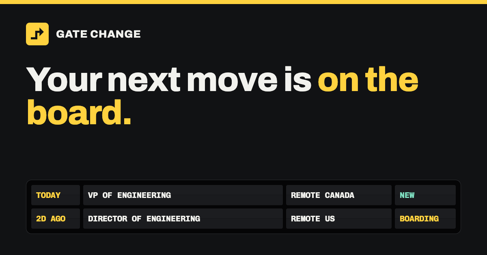

# Gate Change

A job board for engineering leaders: engineering managers, directors, heads of engineering and VPs of engineering. It lists roles that are remote in Canada, remote in the US, or based in Vancouver and British Columbia.

Site: <https://gatechange.dev>



## What it does

- Reads 804 public company job boards on Greenhouse, Ashby, Lever and Workable, plus Remote OK, Remotive, Himalayas, Jobicy and the monthly Hacker News "Who is hiring?" thread.
- Keeps only leadership titles, and tags each role with where it can be worked from, such as remote Canada, remote US, or Vancouver and BC.
- Lists every role a company board still lists, however old the posting, and ranks older roles lower. Takes aggregator roles posted in the last 30 days.
- Removes a role when its company board stops listing it, so the board does not show ghost jobs. Aggregators return only their newest postings, so a role they stop listing stays until 30 days after it was posted.
- Links every listing to the original posting, and prefers the company's own board over an aggregator copy of the same role.
- Shows the freshest, most relevant roles first. Relevance adds weights for role, region, a stated salary and remote work, then subtracts 2.5 points per day of age.
- Serves the board over MCP, so an agent can search it for you.

The board is free. The free tier has every listing, search and filters, an application tracker, and a weekly email digest for each saved search. Pro costs $5 a week. It adds instant email alerts, salary and seniority filters, company intel, and agent tokens. Pro never hides a listing. Every listing is public.

## Use it with your agent

Add the MCP server to Claude Code:

```sh
claude mcp add --transport http gate-change https://gatechange.dev/mcp
```

Any MCP client that speaks streamable HTTP can use the same URL. Without a token, the server exposes three tools: `listJobs`, `getJob` and `boardStats`. It allows 30 calls a minute.

Pro members can create an agent token on their account page and pass it as a header:

```sh
claude mcp add --transport http gate-change https://gatechange.dev/mcp --header "Authorization: Bearer <your-token>"
```

A token raises the limit to 120 calls a minute. It also adds tools to save searches (`saveSearch`, `savedSearches`, `deleteSearch`) and to track applications (`trackJob`, `trackedJobs`, `noteTrackedJob`, `untrackJob`).

The server returns listings only from sources whose terms do not forbid agent access.

## Run your own

You can run your own copy of the board on your own Cloudflare account. It runs on your `workers.dev` subdomain, so you do not need a domain. `pnpm self-host` checks your inputs, then runs [Alchemy](https://alchemy.run) against a stage that you name. Alchemy creates the D1 database, applies the migrations in `packages/job-store/migrations/`, creates the enrichment queue, and deploys both Workers with their cron triggers.

### Prerequisites

- A Cloudflare account. Workers Paid ($5 a month) is recommended. Workers Free works with one extra setting, described in [Cost](#cost).
- Node 24.18 or later.
- pnpm 11.3. Run `corepack enable` to use the version pinned in `package.json`.

### Deploy

> **Warning.** `pnpm self-host` deploys to the Cloudflare account that your credentials resolve to. `CLOUDFLARE_ACCOUNT_ID` with `CLOUDFLARE_API_TOKEN` (or `CLOUDFLARE_API_KEY`) wins over `ALCHEMY_PROFILE`. A value in your shell wins over `.env.local`. Before each run, the command prints the credential source and the account id it will use. Check that account first.

1. Clone the repository and install dependencies:

   ```sh
   git clone https://github.com/rowlandekemezie/jobs.git
   cd jobs
   pnpm install
   ```

2. Give Alchemy your Cloudflare credentials. Either create a profile and set `ALCHEMY_PROFILE=mine`:

   ```sh
   pnpm alchemy profile create mine
   pnpm alchemy profile edit --profile mine --add Cloudflare
   ```

   Or set `CLOUDFLARE_API_TOKEN` and `CLOUDFLARE_ACCOUNT_ID`. Alchemy's `default` profile is never used.

3. In the Cloudflare dashboard, open **Workers & Pages** and note your account's `workers.dev` subdomain.
4. Copy `.env.example` to `.env.local` and set these values:
   - `ALCHEMY_PROFILE`, if you created a profile.
   - `WORKERS_SUBDOMAIN`, the subdomain from step 3. The build uses it as the site's own host, so the site trusts its own sign-in host and never links a listing back to itself.
   - `BETTER_AUTH_SECRET`, at least 32 characters. Generate one with `openssl rand -hex 32`.
   - `INGEST_FEEDS_PER_RUN=8`, only on Workers Free.

5. Preview the plan, then deploy:

   ```sh
   pnpm self-host plan --stage self
   pnpm self-host deploy --stage self
   ```

The site is at `https://jobs-self.<subdomain>.workers.dev`. It fills over the first few cron runs, which run every 20 minutes.

### Commands

`pnpm self-host [plan|deploy|destroy] --stage <name> [--yes]`

| Command | What it does |
| --- | --- |
| `pnpm self-host plan --stage <name>` | Prints the changes Alchemy would make. Changes nothing. |
| `pnpm self-host deploy --stage <name>` | Creates or updates every resource of the stage. |
| `pnpm self-host destroy --stage <name>` | Removes every resource the stage created. |

- The action defaults to `plan` and the stage defaults to `self`.
- The command reads `.env.local` through [varlock](https://varlock.dev). It checks every input before it builds anything, and stops with a list of what is missing.
- A stage name is lowercase letters, digits and hyphens, starts with a letter, and has at most 40 characters.
- The command refuses the stage names `prod`, `preview` and `pr-<n>`. This repository uses them for its own deployments.
- `deploy` and `destroy` ask you to type `y`. Without a terminal to answer, they refuse unless you pass `--yes`. Pass `--yes` only after a `plan` run has shown you the account.

### Cost

Workers Paid ($5 a month) is recommended. Workers Free allows 50 subrequests per cron run, so set `INGEST_FEEDS_PER_RUN=8` there. D1, the queue and the cron triggers are on both plans. On Workers Free, Workers AI stops at 10,000 neurons a day. If you turn on enrichment there, also set `ENRICHMENT_DAILY_NEURONS=10000`.

### Optional features

Each feature is off while its variables are empty. `.env.example` describes every variable.

- **AI enrichment.** Workers AI reads each company-board listing for salary, seniority and other details. Your stage makes no Workers AI calls until you set `ENRICHMENT_SWEEP_LIMIT`, for example to 8. `ENRICHMENT_DAILY_NEURONS` caps daily spend. The default cap of 29000 keeps a month under about $10.
- **GitHub or Google sign-in.** Set both `GITHUB_CLIENT_ID` and `GITHUB_CLIENT_SECRET`, or both Google variables. If a pair is empty, the site hides that button.
- **Email sign-in links and digests.** These need Cloudflare Email Sending on the zone of `MAIL_HOSTNAME` (`packages/core/src/site.ts`). Mail comes from `sign-in@` and `digest@` that hostname. Without it, the board works, but sign-in links and digests fail to send.
- **Paid plans.** Set `BILLING_ENABLED=true` and `PRO_PLANS`, then add a Stripe test key to your Alchemy profile with `pnpm alchemy profile edit --profile mine --add Stripe`.
- **Search engines.** Every stage except `prod` sends `noindex`. To be indexed, point `SITE_HOSTNAME` in `packages/core/src/site.ts` at a hostname in a zone on your account. List only hostnames in your zones in `SITE_REDIRECT_HOSTNAMES`, or leave it empty. Then deploy the `prod` stage, as [docs/operations.md](docs/operations.md#deploy-production-from-your-machine) describes.

The footer, the about, contact, privacy and terms pages, and the crawler's user agent name this deployment. To rebrand your copy, edit `packages/core/src/site.ts`, `apps/web/src/features/information/view.ts`, `apps/web/src/client/board/view.ts` and `packages/job-sources/src/http.ts`.

A "Deploy to Cloudflare" button cannot deploy this app. The button deploys one Worker from a directory that builds with no workspace dependencies. This app is two Workers joined by a service binding, and both depend on workspace packages.

## Develop locally

`pnpm dev` runs `alchemy dev`. It serves the website, `JobsBackend` and a local D1 on `localhost`. `alchemy dev` keeps its stage records in the Alchemy state store on your Cloudflare account, so set up credentials as in [Deploy](#deploy) step 2. `pnpm dev` does not read `.env.local`. Export these in your shell first:

```sh
export ALCHEMY_PROFILE=mine
export BETTER_AUTH_SECRET="$(openssl rand -hex 32)"
export AUTH_EXTRA_HOSTS='localhost:*'
pnpm dev
```

The local board starts empty and fills from live sources on each cron run.

Run the gate before you open a pull request. CI runs the same gate on every pull request:

```sh
pnpm turbo run check test build
```

`pnpm fix` applies the formatter and safe lint fixes. [AGENTS.md](AGENTS.md) is the contributor law: commands, architecture rules, and what needs the owner's sign-off. [VISION.md](VISION.md) sets product intent.

### Architecture

```text
cron (every 20 min) ─▶ JobsBackend.runIngest
                         ├─ picks the feeds that are due (oldest first, backoff on failure)
                         ├─ fetches each feed and keeps only leadership titles
                         ├─ upserts what a feed listed, marks what it stopped listing departed
                         └─ prunes departed and expired roles and records a run receipt

browser ─▶ Website ─▶ /rpc ─▶ JobsBackend ─▶ D1
agent   ─▶ Website ─▶ /mcp ─▶ JobsBackend ─▶ D1
```

| Path | What it holds |
| --- | --- |
| `packages/core` | Schemas, contracts, role and region classifiers, ranking, feed scheduling, source terms, and the ingest run |
| `packages/capability` | Turns one contract into RPC, HTTP, MCP and CLI endpoints |
| `packages/job-sources` | Feed adapters for each job board and aggregator, and the company list in `src/boards.ts` |
| `packages/job-store` | The D1 store and its migrations |
| `packages/job-enrichment` | The Workers AI enricher and its queue |
| `packages/accounts` | Sign-in with better-auth, sessions and email send limits |
| `packages/billing` | Stripe Checkout, the billing portal and webhooks |
| `packages/digest-mailer` | Digest and alert emails, and unsubscribe links |
| `apps/api` | The `JobsBackend` Worker: RPC, MCP, cron jobs and the enrichment queue consumer |
| `apps/web` | The Foldkit UI and the website Worker that renders pages at the edge |
| `apps/infra` | The Alchemy stack and `pnpm self-host` |

### What is in the stack

The workspace `package.json` files pin every version. The main parts are [Effect](https://effect.website) 4, [Alchemy](https://alchemy.run) for Cloudflare Workers, D1, Queues and Workers AI, [Foldkit](https://github.com/foldkit/foldkit) for the UI, better-auth, and Stripe. The workspace started from the [rat-stack](https://github.com/joelhooks/rat-stack) template.

### Common changes

- Add a company: append `{ ats, name, slug }` to `packages/job-sources/src/boards.ts`. The slug is the one in the company's public board URL.
- Change which titles count as leadership roles: `packages/core/src/role.ts`.
- Change how locations map to regions: `packages/core/src/location.ts`.
- Change ranking weights: `roleWeight`, `regionWeight` and the bonuses in `packages/core/src/posting.ts`.

## Sources

Gate Change reads public job APIs and feeds, and uses each one within its published terms.

- Every listing links to its original posting.
- The footer credits each aggregator with a link: Remote OK, Remotive, Himalayas, Jobicy and Hacker News.
- The crawler identifies itself with the `USER_AGENT` in `packages/job-sources/src/http.ts`.
- Each source has a minimum refresh interval. Company boards and most aggregators are fetched at most every two or three hours, Hacker News every six hours and Remotive every twelve.
- `packages/core/src/source-terms.ts` records each source's published terms. The board applies them. For example, email alerts include only sources whose terms allow alerts, and the MCP server leaves out sources whose terms forbid agent access.

If you run a source and want a change, open an issue.

## License

MIT. See [LICENSE](LICENSE). Parts of the code come from other MIT-licensed projects, and the fonts are under the SIL Open Font License. [THIRD_PARTY_NOTICES.md](THIRD_PARTY_NOTICES.md) reproduces their notices, and [PROVENANCE.md](PROVENANCE.md) lists each borrowed file.
